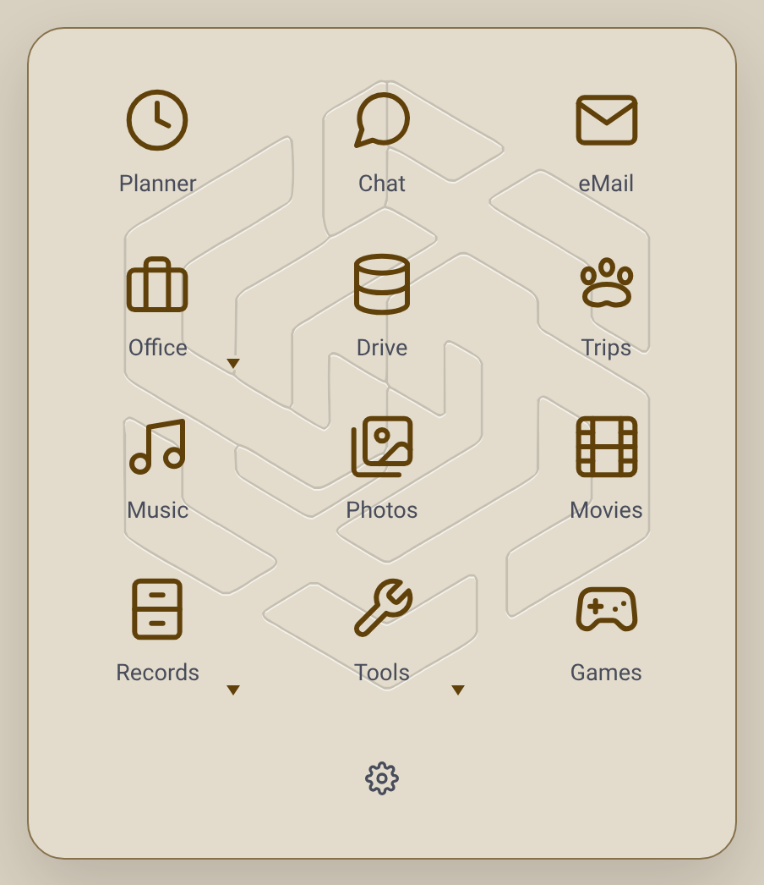

<div align="center">

# Nayive

**Your own cloud, on your own server.**

Drive, Office, eMail, Chat, Photos, Calendar and more: personal web apps you host yourself.<br>
One small Go program, no database, your data in plain files.

[**Download**](https://github.com/peyrona/nayive/releases/latest) · [Install](#install) · [Built on Ayni](https://github.com/peyrona/ayni)



</div>

## The apps

| | |
|---|---|
| **Files** | Drive, Photos, Music, Movies, an image editor |
| **Office** | Write (.docx), Calc (.xlsx), Text (Markdown), Calculator |
| **Talk** | eMail, Chat with voice and video calls |
| **Plan** | Calendar, Tasks, Habits, Trips, Split (shared expenses) |
| **Keep** | Contacts, Bookmarks, locked documents |
| **More** | Games, Language tools, an admin panel |

## Why Nayive

- **Yours.** Your files stay on your server, as plain `.docx`, `.ics`, `.vcf` and `.json` you can read without Nayive.
- **Simple.** One static binary and a folder. No database, no containers, nothing to keep in sync.
- **Everywhere.** Installs as an app on phones, tablets and computers, with notifications. Big screens get a real desktop with windows and a taskbar.
- **For the family.** Many users, each with their own space, sharing by link.
- **Android app** for photo backup and location sharing on trips.

Works in any browser from 2024 on: Chrome or Edge 119+, Firefox 128+, Safari 18+ (iPhone and iPad too).

## Install

On a Linux server (Go is not needed):

```sh
unzip nayive.zip -d nayive        # from the latest release
cd nayive
./install.sh                      # sets up the server and a systemd service
```

Then open `http://localhost:4343/nayive/admin.html` and create the admin account.

<details>
<summary>Run from source, build the zip, deploy</summary>

Needs Go 1.27+.

```sh
mkdir -p store/config store/homes
cp store/config/server.example.json store/config/server.json
cd server/go && go run . -config ../../store/config/server.json   # http://localhost:4343/nayive/
```

- `./pack.sh` builds `nayive.zip` (`GOARCH=arm64` for a Raspberry Pi or an ARM server).
- `./deploy.sh` copies it to your own VPS; put your user, host and SSH port in `deploy.local.sh` (copy `deploy.local.sh.example`).
- Write runs on [docx-editor.dev](https://github.com/eigenpal/docx-editor); its bundle is in the repo. To rebuild it see `client/apps/write/lib/docx-editor/BUILD.md`.

| Folder | What it holds |
|---|---|
| `server/go/` | the server (Go) |
| `client/apps/` | what the browser loads |
| `store/` | settings and every user's data (git-ignored) |
| `android/` | the Android app |
| `tools/` | build and check helpers |

</details>

## Licence

[Apache 2.0](LICENSE)
